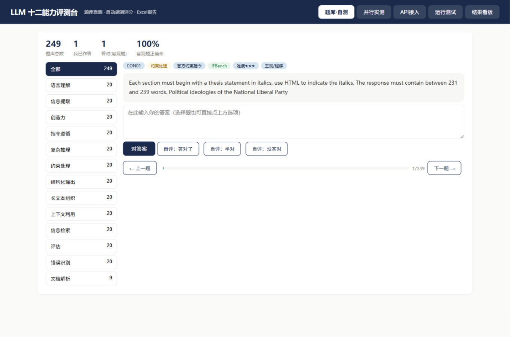
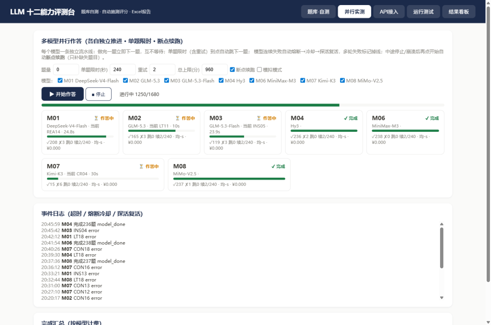
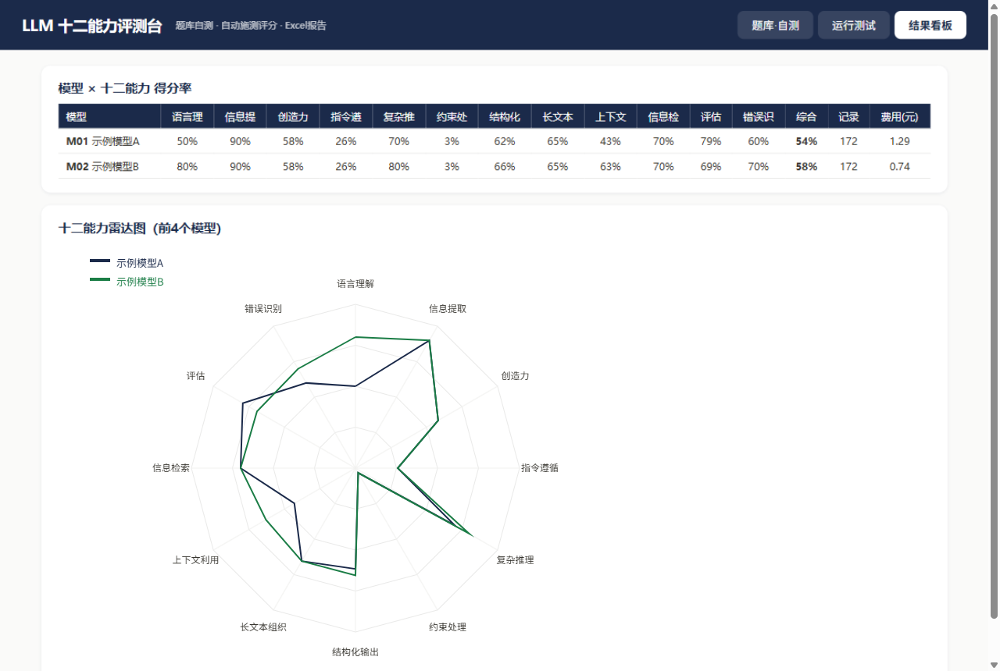
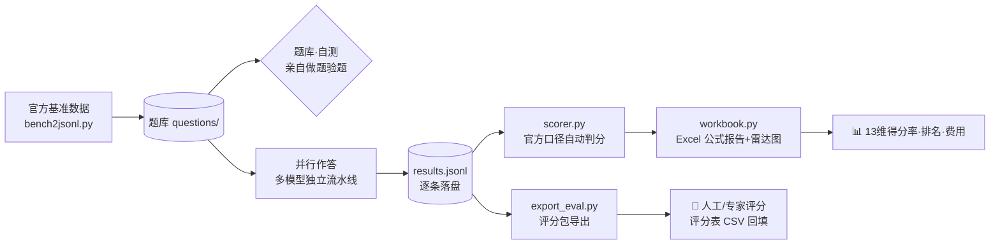

<div align="center">

# 🎓 LLM-Eval Studio

**大模型多维能力评测台 · 从出题、监考到人工评分交卷的一站式工具**

统一施测 · 官方基准原题 · 程序客观判分 · 多模型并行作答 · 一键导出人工评分包

[](https://www.python.org/)
[]()
[](LICENSE)
[](#-题库构成全部官方基准)
[](#-安全说明)

*题库自测 · 并行作答 · 结果看板 · 评分包导出，一个本地网页全搞定*

</div>

---

## 📸 一眼看懂

| 题库 · 自测（可亲自做题） | 并行作答（多模型同时开考） | 结果看板（雷达图 + 评分包） |
|:---:|:---:|:---:|
|  |  |  |

---

## ✨ 它解决什么问题

市面上跑分榜单很多，但没人能回答：**"用我觉得靠谱的题、按我信得过的判法，这几个模型到底谁强？"**

LLM-Eval Studio 把一次严肃评测拆成四件事，全部本地完成：

1. **出题** —— 249 道题全部取自官方基准（高考真题、CLUE、LongBench、IFBench、GSM8K/MATH、BEIR、HaluEval……），**原题原文、不翻译、不改编**，判分口径与官方对齐
2. **监考** —— 多个模型并行作答，单题限时、失败熔断、断点续跑，你只管点"开始"
3. **判分** —— 客观题按官方口径程序自动判（零 API 依赖、可复核），主观题可选 LLM 评审作参考
4. **交卷** —— 一键导出「题目 + 官方答案 + 各模型作答」评分包，判分权交还给人和专家

> 💡 **设计哲学**：权威性外包给官方基准（我们不发明任何标准）；自动化服务于可信度而不是替代判断；为真实的网络环境设计（断网、限流、慢模型都考虑在内）。

---

## 🚀 快速开始

```bash
# 1) 安装依赖
pip install openpyxl pyyaml pyarrow jsonschema nltk absl-py emoji syllapy immutabledict

# 2) 启动评测台（自动打开浏览器）
python app.py            # Windows 可双击 启动评测台.bat

# 3) 不花钱先体验全流程
「运行测试」→ ① 模拟全流程（不联网，内置模拟模型）
```

接入真实模型：**「API 接入」页 → 填 base_url / API Key / 模型名 → 行内「测连接」→ 保存**。支持 OpenAI 兼容接口，Key 可用 `env:环境变量名` 引用。

然后到 **「并行作答」页 → 勾选模型 → ▶ 开始作答**，跑完在 **「结果看板」→ 📦 导出评分包**。

命令行形态（与网页等价）：

```bash
python runner.py --mock            # 离线模拟施测
python race.py --limit 20          # 并行作答(正式)
python scorer.py                   # 三层评分
python workbook.py                 # 生成 Excel 报告(同步桌面副本)
python export_eval.py              # 导出人工评分包
python bench2jsonl.py              # 从基准原始数据重新抽样生成题库
```

---

## 🏗️ 工作流



---

## 📚 题库构成（全部官方基准）

**249 题 · 13 个维度**，每题可溯源（`src` / `src_detail` 字段），旧版自编题库归档于 `questions_archive/`。

| 维度（题数） | 官方基准 | 语言 | 判分口径 |
|---|---|---|---|
| 语言理解 (20) | CLUE：afqmc + c3 | 中文 | 官方标注，选项判分 |
| 信息提取 (20) | CLUE：cmrc2018 | 中文 | 官方字符级 F1 |
| 创造力 (20) | LiveIdeaBench（Nature Comm. 2026） | 英文 | 官方 orig/feas/flue 三维评审 |
| 指令遵循 (20) | IFBench（AllenAI）单约束 | 英文 | **官方校验器逐条判分**（已内置） |
| 约束处理 (20) | IFBench 多重约束 | 英文 | 同上 |
| 复杂推理 (20) | CoT Hub 收录：GSM8K + MATH-500 | 英文 | 数值 / LaTeX 归一化 |
| 结构化输出 (20) | jsonschemabench | 英文 | jsonschema 程序校验 |
| 长文本组织 (20) | LongBench：vcsum + qmsum | 中英 | 字符级 F1 |
| 上下文利用 (20) | LongBench：段落检索 + 多跳问答 | 中英 | 定位判分 / F1 |
| 信息检索 (20) | BEIR：scifact | 英文 | 官方 qrels 定位判分 |
| 评估 (20) | MT-Bench 人工评审数据 | 英文 | 与人工金标对比 |
| 错误识别 (20) | HaluEval | 英文 | 官方幻觉标注二选一 |
| 文档解析 (9) 🖼️ | OmniDocBench 多模态 | 中英 | 页面图→Markdown，官方标注重建 F1 |

> 🖼️ 文档解析为**多模态支线**：仅对开启视觉能力的模型施测，与纯文本模型分开呈现。

---

## 🎯 评分体系（三层，按可信度分级）

| 层级 | 覆盖 | 依赖 | 可信度 |
|---|---|---|---|
| ① 程序客观判分 | 选择/短答/数值/LaTeX/F1/Schema/约束（约 9 成题目） | **零 API 依赖**，官方口径可复核 | ★★★★★ |
| ② LLM 评审（参考） | 创造力等主观题，按官方评审维度 | 需配置评审模型 | ★★★ 建议不同厂商，防自偏好 |
| ③ 人工评分（权威） | 全部题目，通过评分包进行 | 评分人 | ★★★★★ 最终结论 |

---

## 🛡️ 为真实环境而设计

- **独立流水线**：每个模型做完一题立即下一题，互不等待——快模型不用陪跑，慢模型拖不了全场
- **单题限时**：默认 240 秒（含重试）到点强制跳题，全场时长可预算（总上限默认 16 小时）
- **熔断 → 冷却 → 复活**：连续失败自动隔离，冷却后探活成功即回归，多轮失败才判掉线
- **断点续跑**：停止 / 崩溃 / 断网后再点开始，自动跳过已完成题目，**已花的钱不白花**
- **逐题落盘**：每条作答实时写入磁盘，任意时刻断电都不丢已完成部分
- **常见网络坑已内置处理**：Cloudflare 签名拦截、思考模型烧光 token 输出空内容、过载退避重试（3s/10s/30s）

---

## 📦 输出物（默认导出到桌面）

| 产物 | 内容 | 用途 |
|---|---|---|
| `测试作答/M01_模型名.md` | 每模型一份统一格式作答文档 | 人读 / 交付 |
| `评分包/` | 题目与官方答案 + 各模型作答（题号一一对应）+ 人工评分表 CSV | **交人工/专家评分** |
| `测试报告.xlsx` | 13 维得分率矩阵、排名、雷达图、tokens 与费用（全公式自动计算） | 汇总呈现 |

> 评分包的官方答案**严格取自基准官方标注**；无固定答案的题目（创意写作/约束/Schema）注明官方判分口径，不含任何自拟答案。

---

## 📁 项目结构

```
llm-eval/
├── app.py                 # 本地网页评测台（题库自测/并行作答/API接入/运行测试/结果看板）
├── 启动评测台.bat          # 双击启动
├── bench2jsonl.py         # 官方基准 → 题库转换器
├── runner.py              # 施测器（OpenAI 兼容，支持多模态/断点/限时）
├── race.py                # 多模型并行作答引擎（独立流水线）
├── scorer.py              # 三层评分（官方口径程序判分 + LLM 评审）
├── workbook.py            # Excel 报告生成（公式汇总 + 雷达图）
├── export_eval.py         # 人工评分包导出
├── questions/             # 题库（249 题 jsonl，每题含来源与判分配置）
├── questions_archive/     # 旧版自编题库（120 题）
├── ifbench/               # AllenAI IFBench 官方校验器（Apache-2.0，随包分发）
├── templates/             # 手动登记 Excel 模板（网页端体验测试用）
├── 评分包/                # 正式跑分交付物：240题官方答案 + 7模型作答 + 人工评分表 + 测试报告
├── docs/                  # 截图
└── models.example.yaml    # 配置示例（真实 models.yaml 不入库）
```

---

## ⚖️ 题库版权与使用声明

本项目**题目版权归各官方基准所有**，此处仅为评测研究目的的少量抽样引用，均已在题目元数据中标注来源：

| 基准 | 许可证 |
|---|---|
| GSM8K / MATH-500 / HaluEval / LiveIdeaBench / IFBench 代码 | MIT / MIT / MIT / MIT / Apache-2.0 |
| LongBench / OmniDocBench / MT-Bench | Apache-2.0 |
| CLUE / BEIR(scifact) | 各自官方协议（研究用途） |
| jsonschemabench | 未标注许可证，仅限内部评测使用 |

**请勿将题库用于商业用途或再分发**；`评分包/` 内含基准题目原文与官方答案的抽样引用及各模型作答，同样仅限研究用途；正式评测建议从各官方渠道获取完整数据集（`bench2jsonl.py` 支持重新生成）。

## 🔒 安全说明

- 仓库不含任何 API 密钥（`models.yaml` 已在 `.gitignore` 中排除，请勿手动加入）
- `models.example.yaml` 提供配置模板，推荐 `env:环境变量名` 方式引用密钥
- 所有请求发往你自己配置的接口，本项目无任何遥测

## 📄 License

工具链代码以 [MIT](LICENSE) 协议开源；题库内容遵循上方各基准各自的许可。

---

<div align="center">

**如果对你有帮助，欢迎 ⭐ Star**

*Built with 📝 for fair & reproducible LLM evaluation*

</div>
